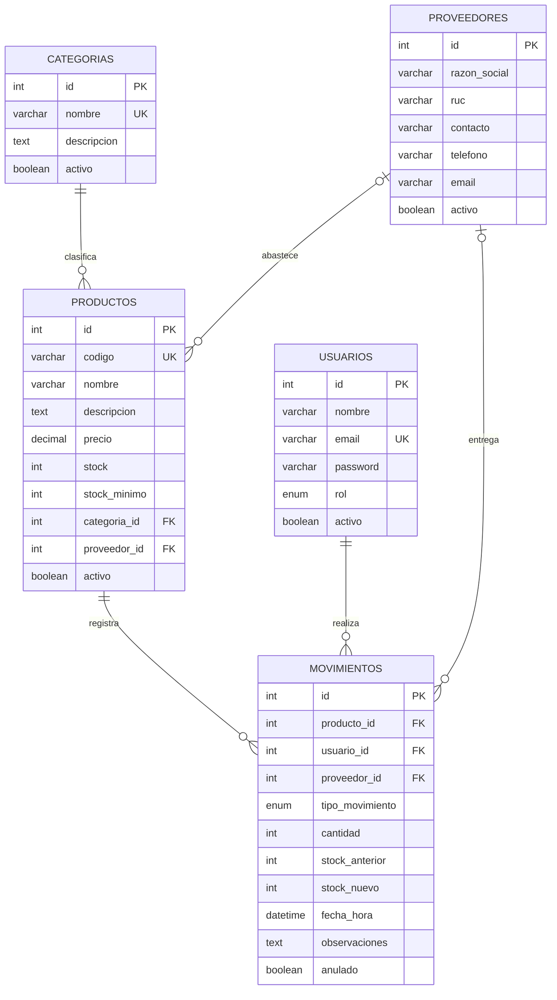

# API de Inventario

API REST del Panel Administrativo de Inventario, hecha con Node.js, Express, Sequelize y MySQL. Incluye modelo relacional, kardex con transacciones, autenticación JWT y control de acceso por rol.

El frontend está en el repositorio `app-inventario`.

## Requisitos

- Node.js 20.19 o superior (probado con Node 24)
- MySQL 8 (por ejemplo, el de Laragon) en el puerto 3306

## Instalación

```bash
npm install
cp .env.example .env     # en PowerShell: Copy-Item .env.example .env
```

Completa el `.env`. Como mínimo, genera un `JWT_SECRET`:

```bash
node -p "require('crypto').randomBytes(48).toString('hex')"
```

Con MySQL encendido, carga los datos de ejemplo y arranca el servidor:

```bash
npm run seed
npm run dev
```

La API queda en `http://localhost:3006`. La base de datos y las tablas se crean solas al arrancar.

También puedes restaurar la copia incluida en `database/api-db.sql` desde HeidiSQL. Para retomar el proyecto en otra computadora, sigue [docs/CONTINUAR.md](docs/CONTINUAR.md).

## Comandos

| Comando | Qué hace |
|---|---|
| `npm run dev` | Arranca con `nodemon`, que reinicia al guardar |
| `npm start` | Arranca sin reinicio automático |
| `npm run seed` | Crea datos de ejemplo. Se puede repetir: solo agrega lo que falta |

## Variables de entorno

| Variable | Ejemplo | Descripción |
|---|---|---|
| `PORT` | `3006` | Puerto de la API |
| `DB_HOST` | `localhost` | Servidor de MySQL |
| `DB_NAME` | `api-db` | Base de datos |
| `DB_USER` | `root` | Usuario de MySQL |
| `DB_PASS` | | Contraseña de MySQL. Vacía en Laragon |
| `JWT_SECRET` | | Clave para firmar los tokens. Obligatoria: sin ella la API no arranca |
| `JWT_EXPIRES_IN` | `2h` | Duración del token |
| `CORS_ORIGINS` | `http://localhost:5173` | Orígenes permitidos, separados por coma |
| `RATE_LIMIT_WINDOW_MS` | `900000` | Ventana de los límites, en milisegundos |
| `RATE_LIMIT_MAX` | `1000` | Peticiones por ventana en `/api/` |
| `RATE_LIMIT_LOGIN_MAX` | `10` | Intentos de login por ventana |
| `ADMIN_EMAIL` | `admin@inventario.test` | Correo del Administrador que crea el seed |
| `ADMIN_PASSWORD` | | Contraseña de ese Administrador |
| `SEED_ALMACENERO_PASSWORD` | | Contraseña del Almacenero que crea el seed |

## Usuarios de prueba

El seed los crea con las contraseñas de tu `.env`. Son solo para desarrollo.

| Rol | Correo | Contraseña sugerida |
|---|---|---|
| Administrador | `admin@inventario.test` | `Admin123*` |
| Almacenero | `almacenero@inventario.test` | `Almacen123*` |

Para probar el rol Supervisor, créalo desde la vista Usuarios o con `POST /api/auth/register`.

## Modelo de datos



Todas las tablas incluyen además `created_at` y `updated_at`.

| Relación | Al borrar el registro padre |
|---|---|
| Categoría → Productos | `RESTRICT`: no se borra si tiene productos, incluidos los inactivos |
| Proveedor → Productos | `SET NULL`: el producto queda sin proveedor |
| Proveedor → Movimientos | `SET NULL`: el movimiento queda sin proveedor |
| Producto → Movimientos | `RESTRICT`: el historial no se pierde |
| Usuario → Movimientos | `RESTRICT`: el historial no se pierde |

## Endpoints

Todas las rutas van bajo `/api`. Salvo el login, requieren el encabezado `Authorization: Bearer <token>`.

| Método | Ruta | Acceso | Filtros y notas |
|---|---|---|---|
| POST | `/auth/login` | Público | Máximo 10 intentos cada 15 minutos |
| POST | `/auth/register` | Administrador | |
| GET | `/auth/perfil` | Autenticado | |
| GET | `/categorias` | Autenticado | Incluye `cantidad_productos` |
| POST | `/categorias` | Administrador | |
| PUT | `/categorias/:id` | Administrador | |
| DELETE | `/categorias/:id` | Administrador | 409 si tiene productos |
| GET | `/proveedores` | Autenticado | |
| POST | `/proveedores` | Administrador | |
| PUT | `/proveedores/:id` | Administrador | |
| DELETE | `/proveedores/:id` | Administrador | |
| GET | `/productos` | Autenticado | `?categoria_id`, `?bajo_stock=1` |
| GET | `/productos/:id` | Autenticado | |
| POST | `/productos` | Administrador, Almacenero | `stock` es el stock inicial |
| PUT | `/productos/:id` | Administrador, Almacenero | Ignora `stock` |
| DELETE | `/productos/:id` | Administrador | Con movimientos queda inactivo |
| GET | `/movimientos` | Autenticado | `?producto_id`, `?tipo`, `?desde`, `?hasta` |
| POST | `/movimientos` | Administrador, Almacenero | |
| PATCH | `/movimientos/:id/anular` | Administrador | |
| GET | `/usuarios` | Administrador | `?rol` |
| PUT | `/usuarios/:id` | Administrador | |
| PATCH | `/usuarios/:id/estado` | Administrador | Cuerpo: `{ "activo": true }` |
| GET | `/dashboard` | Autenticado | |

### Formato de las respuestas

Los listados aceptan `?page`, `?limit` (máximo 100) y `?q`, y ocultan los registros inactivos salvo con `?incluir_inactivos=1`:

```json
{
  "data": [],
  "meta": { "total": 15, "page": 1, "limit": 10, "pages": 2 }
}
```

Todos los errores tienen la misma forma. `detalles` indica el error por campo cuando corresponde:

```json
{
  "ok": false,
  "error": "Datos inválidos",
  "detalles": { "nombre": "El nombre es obligatorio" }
}
```

| Código | Significado |
|---|---|
| 400 | Datos inválidos |
| 401 | Sin token, token inválido o expirado, o usuario desactivado |
| 403 | El rol no alcanza |
| 404 | El recurso o la ruta no existe |
| 409 | Conflicto: registro repetido, stock insuficiente, registro en uso |
| 429 | Demasiadas peticiones |

## Reglas del kardex

Cada movimiento corre en una transacción con la fila del producto bloqueada, así dos movimientos simultáneos no pueden corromper el stock.

| Tipo | Efecto | `cantidad` |
|---|---|---|
| Entrada | `stock += cantidad` | Entero desde 1 |
| Salida | `stock -= cantidad`. 409 si no alcanza | Entero desde 1 |
| Ajuste | El stock pasa a `cantidad` | Stock final deseado, desde 0 |

- El autor sale siempre del token, nunca del cuerpo de la petición.
- El stock solo cambia por el kardex. Al crear un producto con stock, se registra una Entrada "Stock inicial".
- Anular revierte la diferencia que causó el movimiento. No se puede anular dos veces ni si el stock quedaría negativo.
- Un producto inactivo no acepta movimientos.

## Probar con Postman

1. Importa `postman/inventario.postman_collection.json` y `postman/local.postman_environment.json`.
2. Selecciona el entorno **Inventario local**.
3. Ejecuta **Login**: guarda el token en el entorno y las demás peticiones lo usan.

`Register` va después de `Login` porque exige ser Administrador. La colección se puede correr completa con el Collection Runner y crea un producto y un usuario nuevos en cada ejecución. El producto queda inactivo al final.

## Estructura

```text
config/        Conexión a MySQL
controllers/   Lógica de cada recurso
middleware/    Autenticación, límites y errores
models/        Modelos; las relaciones se registran en models/index.js
routes/        Rutas y permisos
services/      Lógica del kardex
src/           Preparación de la base de datos y seed
utils/         ApiError, asyncHandler, paginación y consultas
postman/       Colección y entorno
database/      Copia de la base de datos con datos de ejemplo
docs/          Guía para continuar, plan y scripts de verificación
```
